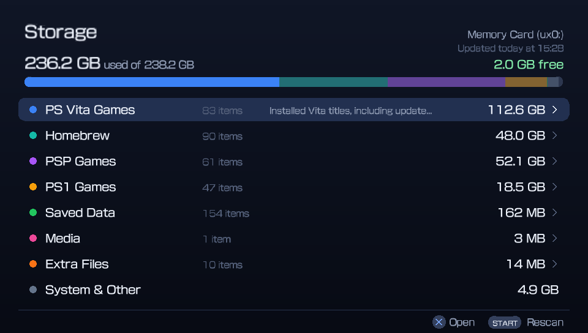
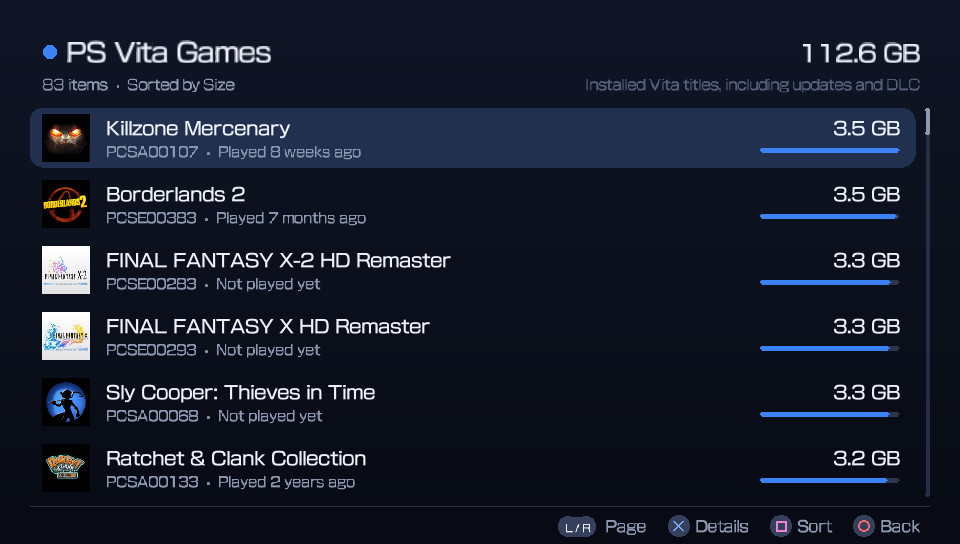
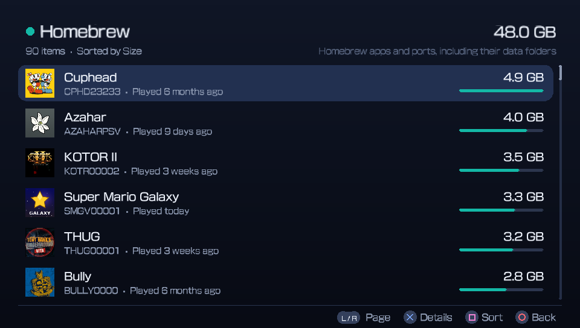
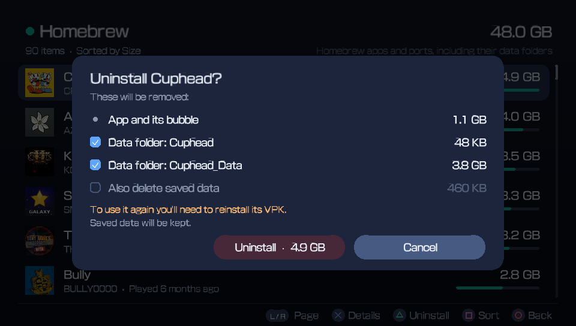
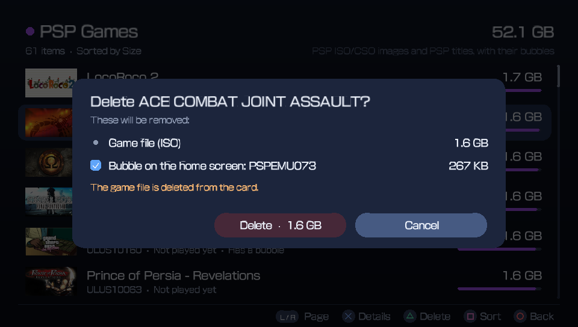

# Vita Storage Manager

See what fills your PS Vita memory card, the way a modern console or phone shows it, and free up space safely.



Vita Storage Manager scans `ux0:` and sorts everything into **PS Vita games, homebrew, PSP games, PS1 games, saved data, media, extra files and system files**, with a colour bar showing how much each one uses. Every entry shows the game's real name and icon, its size, and when it was last played.

## Features

- **Real names, not folder codes.** Titles come from each game's own information: Vita apps, PSP ISO and CSO images (read from inside the image) and PS1/PSP EBOOTs. `ULUS10511.iso` shows up as the actual game title.
- **Sizes that add up.** A Vita game's size includes its update and DLC. A homebrew port includes its `ux0:data` folder, matched to the app automatically.
- **Last played.** Taken from the newest save or data file for each game. Sort any list by size, name or last played.
- **One-step uninstall.** △ on a Vita game or homebrew app opens a checklist: the app and its bubble, update, DLC and data folders. It uses the system's own uninstaller, so there's no need to delete the bubble separately.
- **Your saves, your choice.** "Also delete saved data" is asked every time and is off by default.
- **Adrenaline bubbles.** PSP and PS1 games are linked to the bubbles that launch them, so deleting a game can remove its bubble too. Bubbles left behind by games that are already gone show up under Extra Files.
- **Extra files.** Leftover VPKs and archives, unfinished PKGj downloads, updates and DLC for games that are no longer installed, temporary files and orphaned bubbles, all ready to clean up.
- **Opens instantly.** The first scan reads every file on the card. After that, Storage Manager shows your last results straight away and checks for changes in the background, only re-measuring what changed.

| | |
|---|---|
|  |  |
|  |  |

## Install

1. Install `VitaStorageManager.vpk` with VitaShell.
2. Turn on **Enable Unsafe Homebrew** in HENkaku Settings. Storage Manager needs it to read other apps' folders and to uninstall apps.
3. Open **Storage Manager** from the home screen.

## Controls

| Button | Action |
|---|---|
| ✕ | Open / select (○ on consoles set to confirm with ○) |
| ○ | Back |
| △ | Uninstall or delete the selected item |
| □ | Sort by size, name or last played |
| L / R | Page up / down |
| START | Full rescan |

## Safety

Deleting files can't be undone, so Storage Manager is careful about what it offers:

- **Protected apps can't be uninstalled here:** Storage Manager itself, VitaShell, Adrenaline and Adrenaline Bubbles Manager, PKGj, AutoPlugin II, VitaDeploy, iTLS-Enso, the YAMT installer, ShaRKF00D, RetroFlow's Adrenaline launcher and the PlayStation Mobile runtime.
- **Data folders are only ticked when the match is certain.** A folder matched by a guess, or one several apps can use (such as `retroarch`), starts unticked and is labelled.
- **Saves are protected during an uninstall.** If you keep them, they're moved aside before the app is removed and put back afterwards, even if Storage Manager is closed half-way through.
- **Nothing happens while a scan is refreshing.** Deleting waits until the numbers are current.

## Settings

Storage Manager creates `ux0:data/Storage/settings.txt` on first launch. Edit it to:

```
# Link a ux0:data folder to the app that uses it (use the title ID from the app's details):
data kotor2 = KOTR00002

# Never offer to uninstall an app:
protect VITASHELL

# A data folder several apps use (never ticked for deletion by default):
shared retroarch
```

## Notes and limits

- Only `ux0:` is scanned. Cards mounted as `uma0:` or `imc0:` aren't included yet.
- "Last played" comes from file dates, so a game that never saves shows "Not played yet".
- Media (videos, music, pictures) is shown but managed in the Vita's own apps.
- Diagnostics are written to `ux0:data/Storage/scan.log` and `bubbles.log`. If something looks wrong, these help.

## Building

You need [VitaSDK](https://vitasdk.org) with `libvita2d` and `freetype` (`vdpm install libvita2d freetype`).

```
./build.sh          # builds build/VitaStorageManager.vpk
```

The LiveArea art and logo are generated by `tools/make_livearea.py` (needs Pillow) and are already included in the repository.

## Credits

- Uses the system uninstaller in the same way as [VitaShell](https://github.com/TheOfficialFloW/VitaShell) by TheFloW.
- Built with [VitaSDK](https://vitasdk.org) and [vita2d](https://github.com/xerpi/libvita2d).
- Portions of this software are copyright © 2026 The FreeType Project (www.freetype.org). All rights reserved.
- Developed with AI assistance (Claude).

## License

MIT. See [LICENSE](LICENSE), which also lists the licences of the libraries included in the VPK.
